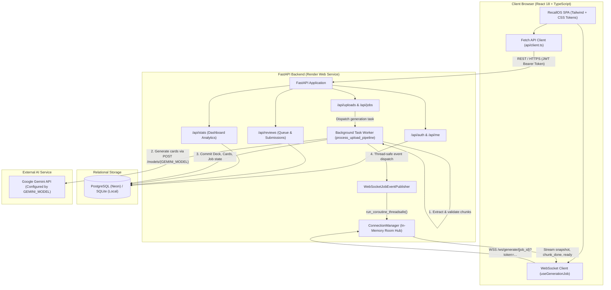

# RecallOS

> An AI-powered spaced repetition learning platform with adaptive exam scheduling and live generation streaming.

---

## 1. Project Name

**RecallOS**  
An AI-powered spaced repetition learning platform that transforms dense study notes into atomic active-recall flashcards, schedules daily revisions using the SM-2 algorithm, and dynamically prioritizes weak topics ahead of exam deadlines.

---

## 2. Problem Statement

Students and self-directed learners face three core bottlenecks when studying technical coursework:
1. **Memory Decay:** Humans forget the majority of unreviewed material within 48 hours of reading it (Ebbinghaus forgetting curve).
2. **Creation Friction:** Manually writing effective, atomic flashcards with challenging distractors from lecture notes takes hours, causing most students to abandon spaced repetition early.
3. **Uncalibrated Schedules:** Existing flashcard tools schedule reviews on static intervals that ignore upcoming exam deadlines, leaving students with no guidance on which topics are weak or what to revise on any given day leading up to an exam.

---

## 3. Target Users

- **College & University Students:** Engineering, medical, and science students preparing for semester examinations with lecture slides, textbook excerpts, and laboratory notes.
- **Bootcamp & Technical Candidates:** Learners studying computer science fundamentals, system design, and algorithms for technical interviews.
- **Exam Preparation Aspirants:** Candidates preparing for competitive exams who possess notes in text or PDF formats (including scanned, photographed, or handwritten-style PDFs).

---

## 4. Solution

RecallOS provides an automated pipeline that ingests study notes (PDF or plain text), partitions them into semantic chunks, and generates atomic multiple-choice flashcards using Google Gemini. The generation progress streams to the student in real time over WebSockets with an automatic polling fallback. Daily study sessions are driven by an implementation of the SuperMemo SM-2 algorithm. When a target exam date is configured, RecallOS activates Exam Mode: review intervals are automatically capped so all cards are seen prior to the exam, and the daily review queue dynamically prioritizes overdue cards and topics where past accuracy falls below 60%.

---

## 5. Key Features

- **Document Upload & Format Support:**
  - Ingestion of text PDFs, plain text (`.txt`), and scanned PDFs up to `MAX_UPLOAD_MB` (default 10 MB).
  - Duplicate upload prevention using SHA-256 content hashing (`Deck.file_hash`). Uploading an identical document returns HTTP 409 with the existing deck ID.
- **Scanned PDF Gemini Vision Processing:**
  - Scanned or image-heavy PDFs (averaging fewer than 150 extracted text characters per page) automatically trigger Vision Mode.
  - Sub-PDFs are sliced purely in memory with `pypdf.PdfWriter` (4 pages per chunk) and transmitted as base64-encoded PDF payloads to the Gemini API.
  - Capped at `MAX_VISION_PAGES` (default 32 pages, max 8 chunks) with an enforced 6-second cooldown between chunks to respect free-tier rate limits. A user notification indicates when pages beyond the cap are skipped.
- **Background Generation with Real-Time WebSocket Streaming:**
  - Card extraction runs asynchronously in a background worker task.
  - Real-time events (`snapshot`, `chunk_done`, `chunk_failed`, `ready`, `failed`) are broadcast to `/ws/generate/{job_id}`.
  - Automatic fallback to HTTP polling (`GET /api/jobs/{job_id}`) if the WebSocket connection fails to establish or disconnects.
- **SM-2 Spaced Repetition Review Engine:**
  - 4 review ratings: **Again** (1), **Hard** (2), **Good** (3), **Easy** (4).
  - Review buttons display predicted next intervals before the student submits a rating.
  - Idempotent submission: clients pass a unique `request_id`; resubmissions return the existing review result without modifying repetition counters or ease factors.
  - Daily review queue is bounded by `DAILY_CARD_LIMIT` (default 50), displaying an indicator for any remaining cards due today.
- **Adaptive Exam Mode:**
  - Configured via target exam date in Settings.
  - **Interval Capping:** Next due dates are capped by `apply_exam_mode_cap`:
    ```text
    exam_cap = exam_date - 1 day
    due_date = max(review_date + 1 day, min(computed_due_date, exam_cap))
    ```
  - **Queue Prioritization:** Due cards are sorted by study urgency:
    ```text
    priority = (1.0 - topic_accuracy) * 0.6 + overdue_days_normalised * 0.4
    overdue_days_normalised = min(1.0, max(0, days_overdue) / 30.0)
    ```
    `topic_accuracy` is calculated from reviews over the last 30 days. Ratings of 3 and 4 count as correct; a neutral value of `0.5` is used when fewer than 5 reviews are available.
- **Analytics Dashboard:**
  - **Overview Stats:** Active review streak, cards due today, total library cards, exam countdown, and estimated exam-day retention.
  - **Estimated Retention on Exam Day:** Computed via Ebbinghaus decay approximation:
    ```text
    R_i = exp(-t_i / S_i)
    t_i = max(0, days_between(last_reviewed_date, exam_date))
    S_i = max(interval_days, 1)
    ```
    Here, `R_i` is the estimated retention for card `i`, `t_i` is the number of days from its last review to the exam (never below zero), and `S_i` is the stability approximation based on its review interval. The dashboard displays the average estimated retention across reviewed cards as a percentage. *Note: this metric estimates memory state assuming no further revision occurs between now and the exam.*
  - **Topic Accuracy Chart:** Horizontal bar chart displaying accuracy per topic with a 60% proficiency reference line and accessible striped patterns for weak topics.
  - **Weak Topics List:** Explicit listing of topics performing below the 60% benchmark.
  - **30-Day Workload Forecast:** Bar chart projecting daily due counts across the next 30 days, folding overdue cards into Day 1.
  - **7-Day Review History:** Daily review volume for the preceding 7 days.
- **JWT Authentication & Data Isolation:**
  - Passwords hashed with bcrypt. Stateless HMAC-SHA256 JWT tokens.
  - All database queries enforce user tenancy (`where(Model.user_id == current_user.id)`). Attempting to access another user's deck, card, or job returns HTTP 404.
- **IST Date Consistency:**
  - Date boundaries, due calculations, and streak evaluations use Indian Standard Time (UTC+5:30) on both backend (`app.core.time`) and frontend (`Intl.DateTimeFormat` with `Asia/Kolkata`), preventing date-shifting bugs around midnight UTC.

---

## 6. Tech Stack

### Backend
- **Language:** Python 3.13.7
- **Framework:** FastAPI `0.115.5`
- **ASGI Server:** Uvicorn `0.32.1`
- **Database ORM:** SQLAlchemy `2.0.36`
- **Database Migrations:** Alembic `1.14.0`
- **Data Validation & Settings:** Pydantic `2.10.3`, Pydantic Settings `2.6.1`
- **Password Hashing:** Bcrypt `4.2.1`
- **Authentication:** PyJWT `2.10.1`
- **PDF Extraction:** PyPDF `5.1.0`
- **HTTP Client:** HTTPX `0.28.1`
- **Testing:** Pytest `8.3.4`
- **Database Driver:** `psycopg2-binary 2.9.10` (production PostgreSQL), SQLite (local development)
- **AI Model Integration:** Google Gemini API configured via the `GEMINI_MODEL` environment variable (model names are not hardcoded in application logic to accommodate Google's model retirement lifecycle).

### Frontend
- **Framework & Language:** React `18.3.1`, TypeScript `5.7.2`
- **Build Tool:** Vite `6.0.7`
- **Routing:** React Router DOM `6.28.0`
- **Styling:** Tailwind CSS `3.4.17`, PostCSS `8.4.49`, Autoprefixer `10.4.20`
- **Design System Tokens:** Pure CSS variables with light and dark themes
- **Icons:** Lucide React `0.469.0`
- **Animations:** Motion `14.7.0` (using `motion/react`)
- **Typography:** `@fontsource-variable/inter 5.3.0` (self-hosted Latin subset)
- **Data Visualization:** Recharts `2.15.0` (code-split and lazy-loaded)
- **Unit Testing:** Vitest `5.0.5`

---

## 7. Architecture

### System Flow Diagram



### Architectural Principles

1. **Database as Single Source of Truth:** All job progress (`done_chunks`, `total_chunks`, `cards_created`, `status`, `error_message`) and extracted cards are committed to the database. The WebSocket connection acts as an ephemeral real-time mirror; if a socket disconnects, the frontend seamlessly recovers the latest state via `GET /api/jobs/{job_id}`.
2. **Thread-Safe Event Publishing:** The background card generation worker executes in a separate thread. Events are scheduled onto FastAPI's main asyncio event loop using `asyncio.run_coroutine_threadsafe(coro, loop)`. Distractors are stripped from card previews before transmission over WebSockets.
3. **Pure Domain Functions:** Core algorithmic calculations (`calculate_sm2` in `app/services/sm2.py`, `apply_exam_mode_cap`, `calculate_topic_accuracy`, and `calculate_card_priority` in `app/services/scheduler.py`, and `calculate_expected_retention` in `app/services/stats.py`) are pure, side-effect-free functions taking explicit dates. They contain no database queries or system clock calls, enabling deterministic unit testing.
4. **Single-Worker Process Constraint:** The backend relies on in-memory sliding-window rate limiters (`IPRateLimiter`, `UserRateLimiter`) and an in-memory WebSocket room registry (`ConnectionManager`). Therefore, the backend must run as a single process (`--workers 1`). Horizontal multi-worker scaling requires migrating rate limiting and socket rooms to a Redis pub/sub layer.

### Directory Structure

```
RecallOS/
├── .env.example                     # Root backend environment template
├── docs/
│   ├── DECISIONS.md                 # Architecture Decision Records (ADRs)
│   └── DEPLOY.md                    # Production deployment documentation
├── backend/
│   ├── alembic/                     # Database migrations
│   │   ├── env.py
│   │   └── versions/
│   ├── alembic.ini
│   ├── app/
│   │   ├── core/                    # Config, DB connection, rate limiting, security, IST time
│   │   ├── llm/                     # Gemini client, base interface, prompt directives
│   │   ├── models/                  # SQLAlchemy declarative models (User, Deck, Card, Job, Review)
│   │   ├── routers/                 # FastAPI routes (auth, uploads, reviews, stats, decks, ws)
│   │   ├── schemas/                 # Pydantic request and response schemas
│   │   ├── services/                # SM-2, scheduler, stats, extractor, generator, validator
│   │   ├── ws/                      # WebSocket ConnectionManager and threadsafe publisher
│   │   └── main.py                  # Application entry point, lifespan, CORS, error handlers
│   ├── scripts/
│   │   └── seed.py                  # Demo account and database seeder
│   ├── tests/                       # Pytest test suite (119 test cases)
│   └── requirements.txt
└── frontend/
    ├── src/
    │   ├── api/                     # HTTP client, authentication, API endpoints
    │   ├── components/              # UI components, dashboard charts, layout, navbar
    │   ├── context/                 # AuthContext, ThemeContext, ToastContext
    │   ├── hooks/                   # useGenerationJob, useCountUp
    │   ├── pages/                   # Dashboard, Upload, Review, Decks, Settings, Auth
    │   ├── styles/                  # tokens.css design system
    │   └── index.css                # Base Tailwind & custom component rules
    ├── package.json
    └── vite.config.ts
```

---

## 8. Local Setup

### Prerequisites
- Python 3.13 or higher
- Node.js 18 or higher with npm
- A Google Gemini API key ([Google AI Studio](https://aistudio.google.com/))

### 1. Backend Setup

#### Windows (PowerShell)
```powershell
cd backend
python -m venv venv
.\venv\Scripts\Activate.ps1
pip install -r requirements.txt

# Configure environment variables
Copy-Item ..\.env.example .env
# Edit .env and supply your GEMINI_API_KEY and GEMINI_MODEL

# Run migrations to initialize SQLite database
alembic upgrade head

# (Optional) Seed demo user, decks, and review history
python scripts/seed.py

# Start development server
uvicorn app.main:app --reload --port 8000
```

#### macOS / Linux (bash/zsh)
```bash
cd backend
python3 -m venv venv
source venv/bin/activate
pip install -r requirements.txt

# Configure environment variables
cp ../.env.example .env
# Edit .env and supply your GEMINI_API_KEY and GEMINI_MODEL

# Run migrations
alembic upgrade head

# (Optional) Seed demo user, decks, and review history
python scripts/seed.py

# Start development server
uvicorn app.main:app --reload --port 8000
```

The API will be accessible at `http://localhost:8000`. Interactive OpenAPI documentation is available at `http://localhost:8000/docs`.

### 2. Frontend Setup

#### All Platforms
```bash
cd frontend
npm install

# Start development server
npm run dev
```

The frontend will run at `http://localhost:5173`. When running locally in development mode without a custom `.env`, the frontend automatically defaults API calls to `http://localhost:8000` and WebSockets to `ws://localhost:8000`.

---

## 9. Environment Variables

### Backend (`.env` / Hosting Provider Config)

| Variable | Required | Description |
| :--- | :--- | :--- |
| `ENV` | Yes | Runtime environment (`development` or `production`). In production, SQLite, default secrets, and wildcard CORS are rejected. |
| `DATABASE_URL` | Yes | SQLAlchemy database connection URL (e.g. `sqlite:///./recallos_dev.db` for local dev; `postgresql://...` for production). |
| `JWT_SECRET` | Yes | Cryptographic secret for signing JWT access tokens (minimum 32 characters in production). |
| `JWT_EXPIRE_MINUTES` | No | Expiration window for access tokens in minutes (default: `1440` = 24 hours). |
| `GEMINI_API_KEY` | Yes | Google Gemini API key for flashcard generation. |
| `GEMINI_MODEL` | Yes | Model identifier (e.g. `gemini-2.5-flash`). Kept configurable so model retirements by Google do not require code changes. |
| `ALLOWED_ORIGINS` | Yes | Comma-separated list of allowed CORS and WebSocket origins (e.g. `http://localhost:5173,http://localhost:3000`). |
| `MAX_UPLOAD_MB` | No | Maximum file upload size in megabytes (default: `10`). |
| `MAX_VISION_PAGES` | No | Maximum pages processed for scanned PDFs in vision mode (default: `32`). |
| `DAILY_CARD_LIMIT` | No | Maximum cards served in a single day's review queue (default: `50`). |
| `ENABLE_DUEL` | No | Feature flag for the planned multiplayer duel feature (default: `false`). |

### Frontend (`frontend/.env` / Vercel Environment)

| Variable | Required in Production | Description |
| :--- | :--- | :--- |
| `VITE_API_URL` | Yes (Production) | Base HTTPS URL of the backend API (e.g. `https://recallos-backend.onrender.com`). |
| `VITE_WS_URL` | Yes (Production) | Base WSS URL of the backend WebSocket server (e.g. `wss://recallos-backend.onrender.com`). |
| `VITE_ENABLE_DUEL` | No | UI feature flag hiding the duel navigation entry (default: `false`). |

---

## 10. Deployment

- **Live Frontend:** [https://recall-os-study.vercel.app](https://recall-os-study.vercel.app)
- **Live Backend API:** [https://recallos-backend.onrender.com](https://recallos-backend.onrender.com) (Health check endpoint: `GET https://recallos-backend.onrender.com/health`)
- **Demo video:** [Watch the RecallOS demo](https://drive.google.com/file/d/1yvAGq8cdToMB8GFPazNpF06CDtY4bTOp/view?usp=drive_link)

### Production Infrastructure Overview
1. **Database (Neon Serverless PostgreSQL):** Managed PostgreSQL instance configured with `sslmode=require`, SQLAlchemy connection pooling (`pool_size=3`, `max_overflow=2`), and `pool_pre_ping=True`.
2. **Backend (Render Web Service):** Python service running `uvicorn app.main:app --host 0.0.0.0 --port $PORT --workers 1`. Migrations run automatically on build via `alembic upgrade head`.
3. **Frontend (Vercel):** Single-page React application built with `npm run build` and served with client-side SPA route rewrites configured in `vercel.json`.

> [!NOTE]
> **Render Free-Tier Spin-Down:** The backend is hosted on Render's free tier. If no requests are received for 15 minutes, the service spins down to conserve resources. The initial wake-up request may experience a cold start latency of **30 to 60 seconds**.

---

## 11. Testing

The codebase includes automated unit and integration tests across both the backend and frontend.

### Backend Test Suite (Pytest)
```bash
cd backend
.\venv\Scripts\pytest.exe -v    # Windows
# or: pytest -v                 # Linux/macOS
```
**Test Results:**
- **118 passed**, **1 skipped** (119 total tests collected).
- The single skipped test (`test_migration_on_postgres`) verifies live PostgreSQL migration rollbacks and is skipped automatically when running against local SQLite.

### Frontend Quality Gates
```bash
cd frontend

# 1. TypeScript compilation check
npx tsc --noEmit

# 2. Vitest unit and integration test suite
npm test

# 3. Production bundle compilation
npm run build
```
**Test Results:**
- TypeScript: `0 errors`
- Vitest: `21 passed` (2 test files: `generationJobState.test.ts`, `SettingsPage.test.tsx`)
- Build: successful build with code-split chunks (Recharts isolated in dynamic chunk `AnalyticsSection.js`).

---

## 12. Security and Engineering Decisions

- **Bcrypt Password Hashing:** User passwords are encrypted with individual salts using `bcrypt.hashpw` before database storage.
- **Stateless JWT Tokens:** Authentication uses HMAC-SHA256 JWT tokens with an enforced 24-hour expiration window.
- **Tenancy Enforcement & Enumeration Prevention:** All deck, card, review, and job queries filter strictly by `user_id == current_user.id`. Accessing a foreign resource ID returns HTTP 404 rather than 403, preventing attackers from confirming the existence of other users' records.
- **CORS & WebSocket Origin Validation:** The backend enforces an explicit origin allowlist (`ALLOWED_ORIGINS`). The `/ws/generate/{job_id}` endpoint checks the `Origin` header prior to handshake acceptance, closing unauthorized origins with code 4403.
- **Tiered Rate Limiting:** Sliding-window in-memory limiters guard endpoints against brute-force attacks:
  - Auth endpoints (`/api/auth/register`, `/api/auth/login`): 30 requests per minute per IP.
  - Upload endpoint (`/api/uploads`): 10 uploads per minute per user.
- **Zero Secrets in Code or Logs:**
  - Google Gemini API keys are passed exclusively via the `x-goog-api-key` HTTP request header, never in URL query strings.
  - A centralized `redact()` utility strips Gemini keys (`AIza...`, `AQ...`), Bearer tokens, query string parameters, and configured secrets from all logs and error messages.
- **Fail-Fast Error Masking:** The database `jobs.error_message` column never stores raw third-party exception strings. Specific HTTP status codes from the LLM provider are mapped to friendly messages (e.g. 401/403 map to `"AI service configuration problem"`; 404 maps to `"The AI service is temporarily unavailable. Please try again later."`).
- **Prompt Injection Defense:** Untrusted study material is encapsulated between `<<<STUDY_MATERIAL_START>>>` and `<<<STUDY_MATERIAL_END>>>` markers accompanied by a system directive commanding the model to treat the content strictly as passive data and ignore embedded instructions.
- **Strict Input Validation:** Uploaded PDFs are checked for magic bytes (`%PDF`), encrypted status, and size caps. Text files require valid UTF-8 encoding.
- **Stranded Job Recovery:** On application startup, the lifespan context executes a SQL query marking any jobs left in `queued` or `processing` states as `failed` (`"Server restarted during processing"`), preventing jobs from hanging permanently if the server restarts.

---

## 13. Known Limitations

1. **Single-Worker Concurrency:** In-memory rate limiting and WebSocket connection tracking (`ConnectionManager`) require the backend to run as a single worker process (`--workers 1`). Running multiple worker instances without an external Redis broker causes WebSocket disconnects and inconsistent rate limit buckets.
2. **Free-Tier Host Latency:** Render's free tier spins down idle instances after 15 minutes, introducing a 30 to 60-second cold start delay on the first inbound request.
3. **Scanned PDF Page Cap:** Scanned PDF processing is capped at `MAX_VISION_PAGES` (default 32 pages) and requires 10 to 20 seconds per 4-page chunk due to multimodal vision inference and API rate-limit cooldowns.
4. **AI Generation Errors:** As with all large language model extractions, generated flashcards and distractors may occasionally contain factual errors or imperfect phrasing.
5. **Retention Metric Assumptions:** The estimated exam-day retention score is an approximation derived from an exponential decay model (`R = exp(-t / S)`) that assumes the student ceases studying entirely from today until the exam date.
6. **Token Storage in LocalStorage:** JWT tokens are stored in the browser's `localStorage` for authentication persistence. This design choice favors implementation simplicity for single-page applications while relying on strict CSP and lack of third-party runtime scripts to mitigate XSS risk.
7. **Account Management:** The current implementation does not include self-service email verification or password reset flows.

---

## 14. Future Work

The following features represent planned enhancements that are **not implemented** in the current release:

1. **Real-Time Multiplayer Quiz Duel:** A real-time competitive game mode over WebSockets where two students test their recall on the same deck simultaneously. The `duels` table schema is currently reserved in the database for this feature, with `ENABLE_DUEL=false`.
2. **Integrated Markdown Notes Editor:** An in-browser notes editor with live preview, syntax highlighting, and diagram support allowing direct conversion from authored notes into flashcards.
3. **Horizontal Scaling via Redis:** Migration of the sliding-window rate limiters and the WebSocket `ConnectionManager` to a Redis key-value store and pub/sub bus to enable multi-worker and multi-instance deployments.
4. **Resilient WebSocket Session Resumption:** Support for client reconnection tokens that allow interrupted WebSocket streams to resume cleanly after temporary mobile network loss.
5. **Automated Due-Card Notifications:** Push notifications or email digests reminding students when flashcards are due for review.
6. **Migration to Official Google GenAI SDK:** Upgrading the current raw HTTPX Gemini client to Google's official `google-genai` SDK with typed structured schema enforcement.

---

## 15. AI Usage

In accordance with academic and submission integrity guidelines, AI assistance was utilized in the following areas during the design and development of RecallOS:

- **Development & Coding Assistance:** An AI coding agent was used for improved implementation and bug fixing based on a technical specification. An AI assistant was used for architecture trade-off discussions, and code review.
- **Product Integration:** The production product integrates Google Gemini via direct REST calls for automated question-and-answer extraction from text and multimodal vision extraction from scanned PDFs.
- **Human Verification:** All generated code was verified by hand:
  - The complete test suites (119 backend Pytest cases, 21 frontend Vitest cases) were executed and validated locally.
  - Manual end-to-end user acceptance testing (registration, upload, streaming generation, SM-2 review, dashboard calculations) was performed on both local and production environments.
  - Security policies, credential redaction patterns, and environment variable isolation were audited manually.

---
