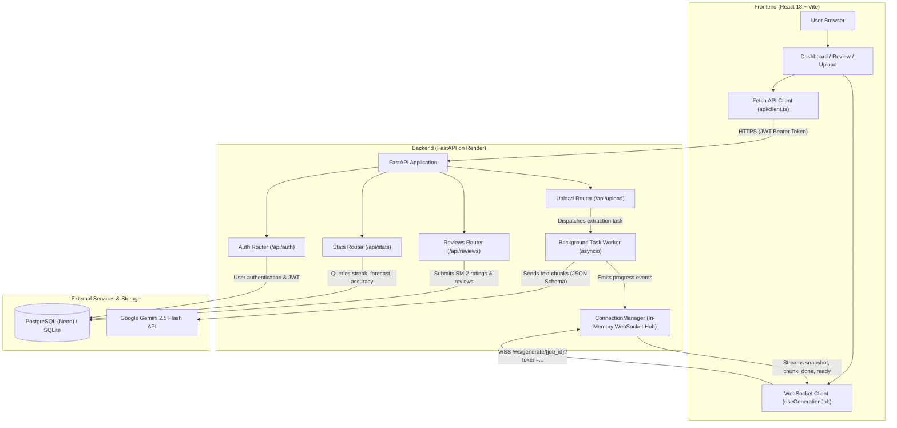

# RecallOS

> **An AI-powered spaced repetition learning operating system with adaptive exam scheduling and live generation streaming.**

---

## Problem Statement

Students, researchers, and technical professionals read hundreds of pages of notes and documentation, yet research shows that humans forget over **70% of newly learned information within 48 hours** (the Ebbinghaus forgetting curve). 

While active recall through spaced repetition is scientifically proven to halt memory decay, existing tools face three fundamental friction points:
1. **High manual creation overhead:** Crafting high-quality, atomic flashcards with challenging options from raw lecture notes is tedious and time-consuming, causing most learners to quit within weeks.
2. **Static scheduling disconnected from deadlines:** Traditional algorithms (like standard Anki SM-2) treat cards uniformly regardless of whether a student's high-stakes exam is in 5 days or 5 months.
3. **Black-box retention metrics:** Learners lack visibility into their actual retention probability and workload forecast leading up to target exam milestones.

---

## Target Users

- **University & College Students:** Preparing for dense semester exams across subjects like Computer Science, Biology, and Engineering.
- **Competitive Exam Candidates:** Aspirants preparing for GATE, GRE, USMLE, or UPSC requiring rigorous revision across dozens of technical topics.
- **Engineers & Technical Professionals:** Developers studying system design, algorithms, and cloud certifications while balancing full-time work.
- **Lifelong Learners:** Individuals reading non-fiction books and research papers who want long-term knowledge retention with minimal manual friction.

---

## Solution

RecallOS replaces the friction of manual flashcard creation with an end-to-end automated retention pipeline:

1. **Upload Notes (PDF / TXT):** Upload dense notes or summaries up to 10 MB.
2. **Real-Time Streaming Generation:** Google Gemini parses the notes into semantic chunks, generating atomic question-answer cards with high-quality distractors. Live WebSocket streaming visualizes chunk-by-chunk progress in real-time.
3. **SM-2 Spaced Repetition Engine:** An implementation of the SuperMemo-2 algorithm schedules daily review queues based on individual card recall performance (ratings 1 to 5).
4. **Adaptive Exam Mode:** When an exam date is set, RecallOS adjusts review priority dynamically, boosting weaker topics (<60% accuracy) and high-decay cards ahead of test day.
5. **Interactive Analytics Dashboard:** Real-time visibility into predicted recall on exam day, 30-day review workload forecasts, 7-day consistency streaks, and topic accuracy benchmarks.

---

## Key Features

### 1. Upload to Cards with Live WebSocket Progress
- Supports both PDF and plain text (TXT) files up to 10 MB.
- Splits large documents into overlapping semantic chunks with deduplication.
- **Dual-Channel Monitoring:** Uses live WebSockets (`/ws/generate/{job_id}`) for instant streaming progress with automatic HTTP polling fallback.
- **Resilient Reconnection:** Handles network dropouts with exponential backoff and terminal state validation.
- Live card preview stream allows immediate inspection of questions, answers, and distractors as each chunk completes.

### 2. SM-2 Spaced Repetition Review
- Full SM-2 implementation adjusting card intervals, repetitions, and ease factors:
  - Rating `1`: Complete blackout (resets repetitions and interval to 1 day).
  - Rating `2`: Incorrect response; recalled after seeing answer.
  - Rating `3`: Correct response recalled with serious difficulty.
  - Rating `4`: Correct response with hesitation.
  - Rating `5`: Perfect, immediate recall.
- **Daily Queue Management:** Enforces a configurable daily card limit (default 50) with indicators showing extra due cards beyond the daily cap.

### 3. Adaptive Exam Mode
- Configure target exam dates directly in user settings.
- Automatically computes remaining days to exam and elevates revision priority for:
  - Topics performing below the 60% accuracy threshold.
  - Cards whose projected retention will decay significantly prior to exam day.

### 4. Interactive Learning Analytics Dashboard
- **5 Overview Stat Cards:** Due today queue, review streak, total deck cards, exam countdown, and predicted recall on exam day.
- **Predicted Retention on Exam Day:** Uses an exponential forgetting curve proxy ($R = \exp(-t / S)$) to calculate estimated recall if revision ceased today. Distinctly handles null cases ("Set exam date", "Exam passed", "Review cards first").
- **Topic Accuracy Chart:** Horizontal bar chart with 60% proficiency reference line, SVG striped pattern for accessible weak-topic identification, and truncated axis labels with full tooltips.
- **30-Day Workload Forecast:** Exact 30-day daily due forecast with overdue cards folded into Day 1 ("Today") and mobile-friendly tick spacing.
- **7-Day Review History:** Histogram displaying daily study volume leading up to today.
- **Zero UTC Shifts:** Safe IST date string formatting prevents timezone day-shifting bugs.
- **Performance Optimized:** Chart libraries (Recharts) are isolated into a separate lazy-loaded bundle chunk wrapped in an `ErrorBoundary` with a reload fallback.

---

## Tech Stack

| Layer | Technology | Details |
| :--- | :--- | :--- |
| **Backend** | Python 3.13 | High-performance asynchronous core |
| **Framework** | FastAPI | RESTful APIs, OpenAPI docs & native WebSocket endpoints |
| **Database** | PostgreSQL / SQLite | Neon serverless PostgreSQL (production) / SQLite (local dev) |
| **ORM** | SQLAlchemy 2.0 | Declarative models with connection pooling and pre-ping |
| **LLM Provider** | Google Gemini 2.5 Flash | Structured JSON schema generation via `google-genai` |
| **PDF Extraction** | PyPDF | Fast local text extraction without external binaries |
| **Testing** | Pytest & Starlette TestClient | 106 unit and integration tests |
| **Frontend** | React 18 & TypeScript | Strict type safety and component modularity |
| **Build Tool** | Vite | Lightning-fast HMR and bundle code-splitting |
| **Styling** | Tailwind CSS | Utility-first responsive design with custom animations |
| **Charts** | Recharts | Interactive SVG data visualizations (lazy-loaded) |
| **Icons** | Lucide React | Accessible, lightweight icon set |

---

## Architecture



---

## Local Setup

### Prerequisites
- Python 3.13+
- Node.js 18+ and npm
- A Google Gemini API key ([Google AI Studio](https://aistudio.google.com/))

### 1. Clone Repository
```bash
git clone https://github.com/w3bxrj/RecallOS.git
cd RecallOS
```

### 2. Backend Setup
```bash
cd backend

# Create and activate virtual environment
python -m venv venv

# Windows:
.\venv\Scripts\activate
# Linux/macOS:
source venv/bin/activate

# Install dependencies
pip install -r requirements.txt

# Configure environment variables
cp ../.env.example .env
# Edit .env and supply your GEMINI_API_KEY

# Seed the database with sample demo data (test user, cards, reviews)
python scripts/seed.py

# Start the development server
uvicorn app.main:app --reload --port 8000
```
Backend API will be available at `http://localhost:8000`. Swagger API docs at `http://localhost:8000/docs`.

### 3. Frontend Setup
```bash
cd ../frontend

# Install dependencies
npm install

# Start the Vite development server
npm run dev
```
Frontend will be available at `http://localhost:5173`.

---

## Environment Variables

### Backend Configuration (`backend/.env`)

| Variable | Description |
| :--- | :--- |
| `ENV` | Environment identifier (`development` or `production`). |
| `DATABASE_URL` | SQLAlchemy database URL (e.g., `postgresql+psycopg2://...` or `sqlite:///./recallos_dev.db`). |
| `JWT_SECRET` | Secret key used to sign authentication tokens (minimum 32 characters in production). |
| `JWT_EXPIRE_MINUTES` | Token expiration duration in minutes (default: `1440` = 24 hours). |
| `GEMINI_API_KEY` | Google Gemini API key for flashcard generation. |
| `GEMINI_MODEL` | Gemini model name (default: `gemini-1.5-flash` or `gemini-2.5-flash`). |
| `ALLOWED_ORIGINS` | Comma-separated list of permitted CORS/WebSocket origins (no wildcards in production). |
| `MAX_UPLOAD_MB` | Maximum permitted file upload size in megabytes (default: `10`). |
| `DAILY_CARD_LIMIT` | Maximum cards presented in a single day's review queue (default: `50`). |
| `ENABLE_DUEL` | Feature flag for the real-time duel game (default: `false`). |

### Frontend Configuration (`frontend/.env.development` / Production env)

| Variable | Description |
| :--- | :--- |
| `VITE_API_URL` | Base HTTP URL of the backend API (e.g. `http://localhost:8000` or production URL). |
| `VITE_WS_URL` | Base WebSocket URL of the backend API (e.g. `ws://localhost:8000` or production URL). |
| `VITE_ENABLE_DUEL` | Feature flag hiding or showing the duel link in navigation (set to `false`). |

---

## Deployment

| Service | Platform | Link |
| :--- | :--- | :--- |
| **Frontend** | Vercel | `[TODO: Insert Live Frontend URL]` |
| **Backend API** | Render | `[TODO: Insert Live Backend URL]` |
| **Demo Video** | YouTube / Loom | `[TODO: Insert Demo Video Link]` |

### Production Deployment Notes
- **Backend (Render Free Tier):**
  - Configured via `render.yaml` with `rootDir: backend`, `plan: free`, `region: singapore`.
  - Start command: `uvicorn app.main:app --host 0.0.0.0 --port $PORT --proxy-headers --forwarded-allow-ips="*"`
  - Runs with exactly **one worker process** to support in-memory rate limiting and the WebSocket `ConnectionManager`.
  - Production database hosted on **Neon PostgreSQL** with `sslmode=require`, `pool_pre_ping=True`, `pool_size=3`, and `max_overflow=2`.
- **Frontend (Vercel):**
  - Build command: `npm run build`
  - Output directory: `dist`
  - Strict SPA route rewriting configured via `vercel.json`.

---

## Demo Credentials

A pre-populated demo account is available out of the box when running `python scripts/seed.py`:

- **Email:** `testuser@example.com`
- **Password:** `password123`

> [!NOTE]
> **Important Note on Demo Data:** Demo data is relative to the seeding date (**27 Oct 2026**). Streak and exam countdown will naturally drift as the calendar advances. Upload your own notes to experience live generation, real-time WebSocket progress, and dynamic retention updates.

---

## Testing

The project includes an automated Pytest test suite covering authentication, SM-2 logic, PDF extraction, live WebSockets, stats calculations, rate limiting, and database constraints.

### Running Backend Tests
```bash
cd backend
# Run full suite
pytest -v

# Run with quiet progress summary
pytest -q
```
**Current Status:** `106 passed` (100% pass rate).

### Running Frontend Validation
```bash
cd frontend
# TypeScript type check (zero errors required)
npx tsc --noEmit

# Production build verification
npm run build
```
*(Notice: The initial bundle remains compact at ~256 kB; Recharts is 100% isolated inside the dynamic lazy chunk).*

---

## Known Limitations

1. **Single Worker In-Memory State:** Rate limiting (30 requests/minute per IP on login/register), active WebSocket connections (`ConnectionManager`), and asynchronous generation tasks run in server memory. Multi-worker or multi-instance scaling requires an external Redis pub/sub layer.
2. **Free-Tier Cold Starts:** Because the backend is deployed on Render's free tier, the service spins down after 15 minutes of inactivity. Initial requests may take **30 to 60 seconds** to wake up.
3. **Scanned / Image-Only PDFs:** Scanned PDFs are processed with Gemini vision fallback (capped at first 32 pages, slower than raw text extraction).

---

## Future Work

The following features are planned enhancements for upcoming iterations (**planned, not implemented in this submission**):

1. **Real-time Quiz Duel:** Two players compete on the same deck over WebSockets with a server-authoritative game engine, reusing the existing `ConnectionManager` (detailed architecture design already documented in `docs/PRD.md` Section 9.2).
2. **Multi-Worker Scaling:** Multi-worker backend support by migrating sliding-window rate limiting and WebSocket room management to Redis.
3. **Resilient WebSocket Sessions:** Reconnect and resume capabilities for dropped WebSocket sessions during generation or review streaming.
4. **Automated Study Reminders:** Push or email reminders notifying students when cards in their decks are due according to their SM-2 schedule.

---

## AI Usage Note

RecallOS integrates **Google Gemini 2.5 Flash** exclusively for automated card generation from student notes. 

- **Prompt Architecture:** The model receives semantic text chunks accompanied by a strict Pydantic JSON schema enforcing atomic questions, concise explanations, and exactly three plausible distractors per card.
- **Structured Output:** All generations use Gemini's native structured JSON mode, eliminating parsing errors or unformatted markdown text.
- **Fail-Safe Processing:** If a particular text chunk fails generation, the worker logs the error without aborting the job, allowing valid cards from adjacent chunks to stream to the student seamlessly.

---
